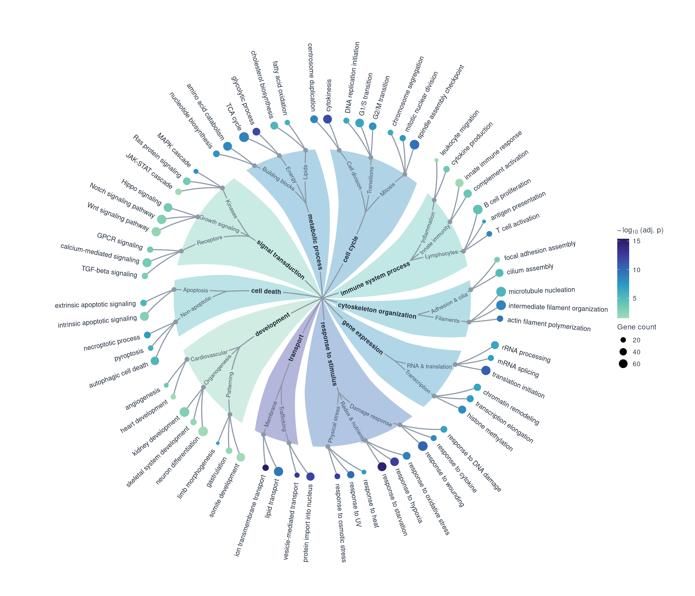

# go_graph

Radial GO-enrichment tree as a ggplot. Each child term is a dot (colour = -log10 p, size = gene count); each parent is a twisted background slice coloured by the mean of its children.



## Use

```r
source("go_graph.R")   # needs ggplot2 and scales

go |> go_graph()
go |> go_graph(twist = 10, wedge_alpha = 0.25) + labs(title = "My enrichment")
go |> go_graph() |> ggsave("go.png", plot = _, width = 14, height = 12)
```

## Input

One row per child term. Default column names (change with arguments):

| argument      | default        | note                                             |
|---------------|----------------|--------------------------------------------------|
| `parent`      | `parent_term`  |                                                  |
| `subcategory` | `subcategory`  | optional, max 3 terms each; auto-split if absent |
| `term`        | `Description`  |                                                  |
| `p`           | `p.adjust`     |                                                  |
| `count`       | `Count`        |                                                  |

Try it with `make_mock_go()` from `mock_data.R`; see `example.R`.

## Main options

`twist` (degrees per ring, default 7), `wedge_alpha`, `text_size`, `palette`, `agg` (how parents are summarised), `radii`, `gaps`. Details are in the comments at the top of `go_graph.R`.
